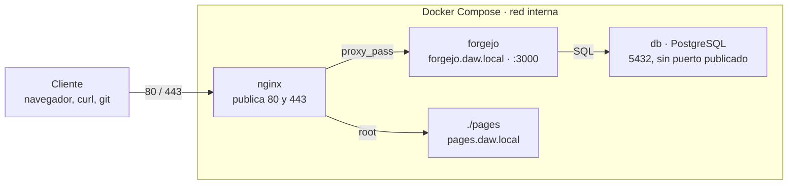

# Práctica guiada: Forgejo detrás de Nginx, paso a paso

Vas a montar tu propio Forgejo y publicarlo como en producción: detrás de Nginx, con dos sitios en el mismo servidor y con HTTPS. Sigue los pasos en orden; cada uno explica qué está pasando y cómo comprobar que ha funcionado. Al final enseñarás al profesor que todo funciona.

## Antes de empezar



Todo el tráfico entra por Nginx. Forgejo y PostgreSQL viven en una red interna de Docker y no se pueden alcanzar desde fuera. Nginx decide a dónde va cada petición mirando el nombre que pidió el cliente.

Cada paso de la guía tiene hasta tres partes:

- **Haz:** los comandos o ficheros. Cópialos, pero léelos antes.
- **Qué está pasando:** la explicación. Es lo que entra en el examen.
- **Comprueba:** lo que tienes que ver. Si no lo ves, no sigas: mira la última sección, «Si algo falla».

Algunos pasos fallan **a propósito**. Están marcados con «Fallo provocado»: son los errores que te encontrarás en cualquier despliegue real, y aprenderás a reconocerlos.

**Necesitas:** Docker con Docker Compose, un terminal, Firefox y `git`. En el aula trabajas con **Docker rootless**: Docker funciona con tu propio usuario, sin permisos de administrador. En ningún paso de esta práctica necesitas `sudo`.

Comprueba que tienes todo:

```bash
docker compose version
git --version
ss -ltn | grep -E ':(80|443) '     # no debe salir nada
```

Si el último comando muestra algo escuchando en el 80 o el 443, avisa al profesor antes de seguir.

Crea la carpeta del proyecto, que usarás en todas las partes:

```bash
mkdir -p ~/practica-http/{nginx/conf.d,nginx/certs,pages}
cd ~/practica-http
```

A partir de aquí, todos los comandos se ejecutan dentro de `~/practica-http`.

## Parte 1. Forgejo y PostgreSQL con Docker Compose

En esta parte levantas Forgejo con su base de datos y lo dejas funcionando en el puerto 3000. Es el punto de partida: todavía no hay Nginx.

### Paso 1.1. Los nombres de tu servidor

**Haz:**

```bash
grep daw.local /etc/hosts
ping -c1 forgejo.daw.local
```

**Qué está pasando.** No tenemos un servidor DNS para estos nombres, así que se le enseñan a tu equipo a mano en el fichero `/etc/hosts`. Ese fichero se consulta antes que el DNS: cualquier programa que pida `forgejo.daw.local` recibirá `127.0.0.1`, tu propia máquina. Editarlo necesita permisos de administrador, así que el profesor ya ha añadido la línea en todos los equipos del aula.

**Comprueba:** el primer comando muestra `127.0.0.1 forgejo.daw.local pages.daw.local` y el `ping` responde desde `127.0.0.1`. Si no sale la línea, avisa al profesor.

### Paso 1.2. Escribir el `docker-compose.yml`

**Haz:** crea `~/practica-http/docker-compose.yml` con este contenido.

```yaml
services:
  db:
    image: postgres:16-alpine
    restart: unless-stopped
    environment:
      POSTGRES_USER: forgejo
      POSTGRES_PASSWORD: forgejo
      POSTGRES_DB: forgejo
    volumes:
      - ./postgres:/var/lib/postgresql/data

  forgejo:
    image: codeberg.org/forgejo/forgejo:16
    restart: unless-stopped
    depends_on:
      - db
    environment:
      USER_UID: "1000"
      USER_GID: "1000"
      FORGEJO__database__DB_TYPE: postgres
      FORGEJO__database__HOST: db:5432
      FORGEJO__database__NAME: forgejo
      FORGEJO__database__USER: forgejo
      FORGEJO__database__PASSWD: forgejo
      FORGEJO__server__DISABLE_SSH: "true"
      FORGEJO__server__ROOT_URL: http://localhost:3000/
    volumes:
      - ./forgejo:/data
    ports:
      - "3000:3000"
```

**Qué está pasando.**

- Hay dos servicios en la misma red de Compose. Dentro de esa red, cada servicio se encuentra por su nombre: Forgejo llega a la base de datos con `db:5432`.
- Las variables `FORGEJO__seccion__CLAVE` rellenan el fichero de configuración de Forgejo, `app.ini`, cada vez que arranca el contenedor. `FORGEJO__database__HOST` es la clave `HOST` de la sección `[database]`.
- Los datos se guardan en las carpetas `./postgres` y `./forgejo` de tu proyecto. Si borras el contenedor, no pierdes nada.
- `ports: "3000:3000"` publica el puerto de Forgejo en tu equipo. Es **provisional**: en la parte 2 lo quitarás.
- Desactivamos SSH para centrarnos solo en HTTP.

### Paso 1.3. Arrancar

**Haz:** primero descarga las imágenes. Con Docker rootless cada usuario tiene las suyas, y la primera vez tarda unos minutos porque toda la clase descarga a la vez.

```bash
docker compose pull
```

Después arranca y mira el log de Forgejo:

```bash
docker compose up -d
docker compose logs -f forgejo
```

Espera a ver en el log una línea que diga que escucha en el puerto 3000 y sal con `Ctrl+C`. Salir del log no para el contenedor.

**Comprueba:** `docker compose ps` muestra `db` y `forgejo` en estado `running`.

### Paso 1.4. Instalar Forgejo

**Haz:** abre `http://localhost:3000`. Verás el asistente de instalación con la base de datos ya rellena gracias a las variables. Baja hasta **Configuración de la cuenta de administrador**, despliégala y crea tu usuario. Pulsa **Instalar Forgejo**.

Si después de instalar no puedes entrar con tu usuario, créalo desde el terminal:

```bash
docker compose exec -u 1000 forgejo forgejo admin user create --admin \
  --username tu_usuario --password 'Cambiar1234!' --email tu_usuario@daw.local \
  --must-change-password=false
```

**Qué está pasando.** `-u 1000` ejecuta el comando como el usuario de Forgejo dentro del contenedor. Como `root`, Forgejo se niega a arrancar por seguridad.

### Paso 1.5. Crear un repositorio de prueba

**Haz:** en Forgejo, botón **+** › **Nuevo repositorio**. Nombre: `prueba`. Marca **Inicializar repositorio** para que tenga un README.

**Comprueba:** ves el repositorio `prueba` con su README. Fíjate en la URL que aparece junto al botón de clonar HTTP: la necesitarás en la parte 2.

## Parte 2. Nginx como proxy inverso

Ahora pones Nginx delante de Forgejo y cierras el puerto 3000. Al final de esta parte solo se podrá entrar a Forgejo a través de Nginx.

### Paso 2.1. Configurar el sitio de Forgejo en Nginx

**Haz:** crea `nginx/conf.d/forgejo.conf`.

```nginx
server {
    listen 80;
    server_name forgejo.daw.local;

    location / {
        proxy_pass http://forgejo:3000;
        proxy_set_header Host              $host;
        proxy_set_header X-Real-IP         $remote_addr;
        proxy_set_header X-Forwarded-For   $proxy_add_x_forwarded_for;
        proxy_set_header X-Forwarded-Proto $scheme;
    }
}
```

**Qué está pasando.**

- Un bloque `server` es un sitio web. Este atiende las peticiones al puerto 80 cuyo nombre sea `forgejo.daw.local`.
- `proxy_pass` reenvía la petición a Forgejo. `forgejo` es el nombre del servicio en el compose, igual que `db` en la parte 1.
- Las cuatro cabeceras le cuentan a Forgejo lo que Nginx sabe y Forgejo no: qué nombre se pidió (`Host`), la IP real del cliente (`X-Real-IP` y `X-Forwarded-For`) y si el cliente llegó por `http` o `https` (`X-Forwarded-Proto`). Sin ellas, Forgejo creería que todas las visitas vienen de Nginx.

### Paso 2.2. Añadir Nginx al compose

**Haz:** añade este servicio al final de `docker-compose.yml`, al mismo nivel que `db` y `forgejo`.

```yaml
  nginx:
    image: nginx:stable-alpine
    restart: unless-stopped
    depends_on:
      - forgejo
    ports:
      - "80:80"
    volumes:
      - ./nginx/conf.d:/etc/nginx/conf.d:ro
```

Y arranca: `docker compose up -d`.

**Qué está pasando.** Montamos tu carpeta `nginx/conf.d` encima de la de la imagen. Así desaparece la página de bienvenida de Nginx y solo quedan tus sitios. El `:ro` lo monta en solo lectura: el contenedor no puede modificar tus ficheros.

**Comprueba:** `http://forgejo.daw.local` (sin puerto) muestra Forgejo.

### Paso 2.3. Cerrar el puerto 3000

**Haz:** borra estas dos líneas del servicio `forgejo` en el compose:

```yaml
    ports:
      - "3000:3000"
```

Y aplica el cambio:

```bash
docker compose up -d
docker compose restart nginx
curl -I http://localhost:3000          # debe fallar
curl -I http://forgejo.daw.local        # debe dar 200 OK
```

**Qué está pasando.** Forgejo sigue escuchando en el 3000, pero solo dentro de la red de Docker, donde Nginx lo alcanza. Desde tu equipo ya no se llega. El `restart nginx` es necesario porque `up -d` ha recreado el contenedor de Forgejo y puede haberle cambiado la IP. Nginx averigua la IP de `forgejo` solo al arrancar y, si no lo reinicias, seguiría apuntando a la antigua.

**Comprueba:** el primer `curl` dice `Connection refused` y el segundo `HTTP/1.1 200 OK` con `Server: nginx`.

### Paso 2.4. Fallo provocado: la URL de clonado

**Haz:** entra en tu repositorio `prueba` y mira la URL de clonado HTTP.

**Qué ves:** `http://localhost:3000/tu_usuario/prueba.git`. Esa dirección ya no existe: acabas de cerrar el 3000.

**Qué está pasando.** Nginx reenvía las peticiones, pero Forgejo no sabe con qué dirección le ve el usuario. Para los enlaces absolutos (clonado, correos, webhooks) usa su URL pública, `ROOT_URL`, que sigue diciendo `localhost:3000`. Cualquier aplicación detrás de un proxy necesita saber su URL pública.

**Haz:** en el servicio `forgejo` del compose, cambia `ROOT_URL` y añade `DOMAIN`:

```yaml
      FORGEJO__server__DOMAIN: forgejo.daw.local
      FORGEJO__server__ROOT_URL: http://forgejo.daw.local/
```

```bash
docker compose up -d && docker compose restart nginx
```

**Comprueba:** recarga el repositorio. La URL de clonado es ahora `http://forgejo.daw.local/tu_usuario/prueba.git`.

### Paso 2.5. Fallo provocado: el error 413

**Haz:** clona el repositorio, añade un fichero de 5 MB y súbelo. Git te pedirá tu usuario y contraseña de Forgejo.

```bash
cd ~
git clone http://forgejo.daw.local/tu_usuario/prueba.git
cd prueba
dd if=/dev/urandom of=grande.bin bs=1M count=5
git add grande.bin
git commit -m "Fichero grande"
git push
```

**Qué ves:**

```
error: RPC failed; HTTP 413 curl 22 The requested URL returned error: 413
fatal: the remote end hung up unexpectedly
```

**Qué está pasando.** `413` significa que la petición es demasiado grande. No lo dice Forgejo sino Nginx, que por defecto solo acepta cuerpos de 1 MB. La petición nunca llega a Forgejo: el proxy la corta antes, y para eso sirve. Míralo en su log:

```bash
cd ~/practica-http
docker compose logs nginx | grep "too large"
```

**Haz:** dentro del bloque `server` de `nginx/conf.d/forgejo.conf`, justo debajo de `server_name`, añade:

```nginx
    client_max_body_size 512m;
```

Y recarga Nginx sin pararlo:

```bash
docker compose exec nginx nginx -t
docker compose exec nginx nginx -s reload
```

`nginx -t` comprueba que la configuración no tiene errores. Hazlo **siempre** antes de recargar.

**Comprueba:** vuelve a `~/prueba` y repite `git push`. Ahora funciona y el fichero aparece en Forgejo.

## Parte 3. Un segundo sitio en el mismo servidor

Vas a servir dos webs distintas con la misma IP y el mismo puerto. Es lo que hace cualquier hosting con miles de dominios.

### Paso 3.1. La web estática

**Haz:** crea `pages/index.html` y pon tu nombre donde se indica.

```html
<!DOCTYPE html>
<html lang="es">
<head><meta charset="utf-8"><title>Pages de TU NOMBRE</title></head>
<body>
  <h1>Hola, soy TU NOMBRE</h1>
  <p>Esta página la sirve Nginx directamente, sin pasar por Forgejo.</p>
</body>
</html>
```

### Paso 3.2. El sitio en Nginx

**Haz:** crea `nginx/conf.d/pages.conf`.

```nginx
server {
    listen 80;
    server_name pages.daw.local;

    root  /usr/share/nginx/pages;
    index index.html;

    location / {
        try_files $uri $uri/ =404;
    }
}
```

En el compose, añade un segundo volumen al servicio `nginx`, debajo del de `conf.d`:

```yaml
      - ./pages:/usr/share/nginx/pages:ro
```

```bash
docker compose up -d
```

**Qué está pasando.** Este `server` no reenvía nada: sirve ficheros de una carpeta (`root`). `try_files` busca primero un fichero con ese nombre, después una carpeta y, si no hay ninguno, responde `404`.

**Comprueba:** `http://pages.daw.local` muestra tu página y `http://forgejo.daw.local` sigue mostrando Forgejo.

### Paso 3.3. Quien decide es la cabecera `Host`

**Haz:** pide las dos webs a la misma dirección, `127.0.0.1`, cambiando solo una cabecera:

```bash
curl -s -H "Host: pages.daw.local"   http://127.0.0.1/
curl -s -H "Host: forgejo.daw.local" http://127.0.0.1/ | grep -i "<title"
```

**Qué está pasando.** Las dos peticiones van a la misma IP y al mismo puerto. Lo único distinto es la cabecera `Host`, y Nginx la compara con el `server_name` de cada bloque. El nombre que escribes en el navegador sirve para dos cosas: averiguar la IP y rellenar esa cabecera. Por eso en HTTP/1.1 es obligatoria.

**Comprueba:** el primer comando devuelve tu `index.html` y el segundo el título de Forgejo.

### Paso 3.4. Fallo provocado: un nombre que no existe

**Haz:**

```bash
curl -s -H "Host: hola.daw.local" http://127.0.0.1/ | grep -i "<title"
```

**Qué ves:** Forgejo, aunque `hola.daw.local` no está configurado en ningún sitio. Lo mismo pasa con `http://localhost`.

**Qué está pasando.** Si ningún `server_name` coincide, Nginx usa el **servidor por defecto** del puerto. Si nadie lo ha marcado como tal, es el primero que carga. Nginx lee los ficheros de `conf.d` en orden alfabético y `forgejo.conf` va antes que `pages.conf`.

**Haz:** crea `nginx/conf.d/00-default.conf`.

```nginx
server {
    listen 80 default_server;
    server_name _;
    return 444;
}
```

```bash
docker compose exec nginx nginx -t && docker compose exec nginx nginx -s reload
curl -v -H "Host: hola.daw.local" http://127.0.0.1/
```

**Qué está pasando.** `default_server` lo marca explícitamente como el servidor por defecto, así que el orden de los ficheros deja de importar. `444` es un código propio de Nginx: cierra la conexión sin responder nada. No le das pistas a quien pregunta por nombres que no son tuyos.

**Comprueba:** `curl` termina con `Empty reply from server`, y `forgejo.daw.local` y `pages.daw.local` siguen funcionando.

## Parte 4. Leer HTTP en crudo

HTTP es texto. En esta parte lo lees directamente, con `curl` y con las herramientas del navegador, y aprendes a distinguir si una respuesta la da la aplicación o el proxy.

### Paso 4.1. Ver solo las cabeceras

**Haz:**

```bash
curl -s -o /dev/null -D - http://forgejo.daw.local/
```

**Qué está pasando.** `-o /dev/null` tira el cuerpo (el HTML) y `-D -` imprime las cabeceras de la respuesta. La primera línea es la **línea de estado**: versión, código y frase. Debajo vienen las cabeceras, una por línea.

**Comprueba:** la primera línea es `HTTP/1.1 200 OK` y entre las cabeceras está `Server: nginx`.

### Paso 4.2. Provocar cada código

**Haz:** ejecuta cada comando, mira la línea de estado y fíjate en la cabecera indicada.

| Qué provocas | Comando | Qué debes ver |
| --- | --- | --- |
| Redirección | `curl -s -o /dev/null -D - http://forgejo.daw.local/user/settings` | `303 See Other` y una cabecera `Location` hacia `/user/login` |
| No autenticado | `curl -i http://forgejo.daw.local/api/v1/user` | `401 Unauthorized` y un cuerpo en JSON |
| No encontrado | `curl -s -o /dev/null -D - http://forgejo.daw.local/nadie/nada` | `404 Not Found` |
| Aplicación caída | `docker compose stop forgejo` y repite el primer comando | `502 Bad Gateway` |

Después del `502`, vuelve a dejarlo todo en marcha:

```bash
docker compose start forgejo
docker compose restart nginx
```

**Qué está pasando.** Los tres primeros códigos los genera Forgejo: Nginx solo los transporta. El `502` lo genera Nginx porque no ha podido hablar con Forgejo. Cuando algo falle en un despliegue, la primera pregunta es siempre: **¿quién ha contestado, la aplicación o el proxy?** La página del `502` es la de Nginx, no la de Forgejo, y eso ya te da la respuesta.

### Paso 4.3. El inicio de sesión visto por dentro

**Haz:**

1. Cierra sesión en Forgejo.
2. Abre las herramientas de desarrollo de Firefox con `F12` y ve a la pestaña **Red**.
3. Inicia sesión.
4. Busca la petición `POST` a `/user/login` y haz clic en ella.

**Qué está pasando.**

- El formulario se envía con `POST` y el servidor responde `303` con `Location: /`. Es el patrón **Post/Redirect/Get**: después de un POST se redirige, así que recargar la página no reenvía el formulario.
- En las cabeceras de la respuesta hay un `Set-Cookie`: así deja el servidor tu sesión en el navegador. A partir de ahí, el navegador la envía en cada petición.

**Comprueba:** en la pestaña **Almacenamiento** › **Cookies** busca la cookie de sesión de Forgejo (suele llamarse `i_like_gitea`). Anota qué atributos tiene: `HttpOnly` (JavaScript no puede leerla), `SameSite` (no viaja en peticiones lanzadas desde otros sitios) y `Secure` (solo viaja por HTTPS). Ahora mismo `Secure` falta: lo recuperarás en la parte 6.

### Paso 4.4. El log de acceso

**Haz:**

```bash
docker compose logs --tail 5 nginx
```

**Qué está pasando.** Cada línea es una petición, con este formato:

```
172.18.0.1 - - [28/Oct/2026:16:10:01 +0100] "GET /user/login HTTP/1.1" 200 12345 "-" "curl/8.5.0"
```

La IP de origen, la fecha, la línea de la petición, el código, los bytes de la respuesta, de dónde venías (`Referer`) y qué programa la hizo (`User-Agent`). La IP no es `127.0.0.1` ni la de tu equipo, sino una IP interna de Docker. Con Docker rootless, los puertos publicados pasan por un proceso intermedio que reenvía las conexiones, y Nginx solo ve a ese intermediario. Es lo mismo que le pasa a Forgejo con Nginx delante, y por eso existen las cabeceras `X-Forwarded-For` y `X-Real-IP` del paso 2.1.

**Comprueba:** localiza en el log tus peticiones de la tabla del paso 4.2 con su código.

## Parte 5. Tu propia autoridad de certificación

Para HTTPS necesitas un certificado. Los públicos los firma una autoridad de certificación (CA) en la que los navegadores ya confían. Aquí vas a crear tu propia CA y a firmar con ella un certificado para tus dos nombres. Es el mismo modelo que usa la red del instituto.

Trabaja dentro de la carpeta de certificados:

```bash
cd ~/practica-http/nginx/certs
```

### Paso 5.1. Crear la CA

**Haz:** pon tu nombre en el `-subj`.

```bash
openssl req -x509 -newkey rsa:4096 -noenc -keyout ca.key -out ca.crt \
  -days 1825 -subj "/CN=CA DAW Tu Nombre"
```

**Qué está pasando.** Generas una clave privada (`ca.key`) y un certificado autofirmado (`ca.crt`) válido 5 años. `-noenc` deja la clave sin contraseña para no tener que escribirla en cada paso.

En esta práctica, `ca.crt` es lo que repartes: lo importarás en el navegador y en Git. `ca.key` es lo más valioso de todo, porque quien la tenga puede firmar certificados en los que tus equipos confiarán. **Nunca sale de esta carpeta**: ni al contenedor ni al repositorio.

### Paso 5.2. Pedir un certificado para el servidor

**Haz:**

```bash
openssl req -newkey rsa:2048 -noenc -keyout daw.key -out daw.csr \
  -subj "/CN=forgejo.daw.local"
```

**Qué está pasando.** Generas la clave del servidor (`daw.key`) y una petición de firma (`daw.csr`). La CSR es lo que en el mundo real se envía a una CA para que la firme.

### Paso 5.3. Indicar los nombres: SAN

**Haz:** crea el fichero `san.ext`.

```bash
cat > san.ext <<EOF
subjectAltName=DNS:forgejo.daw.local,DNS:pages.daw.local
basicConstraints=CA:FALSE
keyUsage=digitalSignature,keyEncipherment
extendedKeyUsage=serverAuth
EOF
```

**Qué está pasando.** El campo `CN` del paso anterior solo admite un nombre, y los navegadores dejaron de mirarlo hace años. Los nombres válidos de un certificado van en la extensión **SAN** (`subjectAltName`), que admite varios. Las otras líneas dicen que no es una CA y que sirve para un servidor web.

### Paso 5.4. Firmar con tu CA

**Haz:**

```bash
openssl x509 -req -in daw.csr -CA ca.crt -CAkey ca.key -CAcreateserial \
  -out daw.crt -days 825 -sha256 -extfile san.ext
```

**Comprueba:**

```bash
openssl x509 -in daw.crt -noout -text | grep -A1 "Alternative Name"
openssl verify -CAfile ca.crt daw.crt
```

Debes ver `DNS:forgejo.daw.local, DNS:pages.daw.local` y `daw.crt: OK`.

### Paso 5.5. Proteger las claves

**Haz:** crea `~/practica-http/.gitignore` para que nunca se suban al repositorio.

```
forgejo/
postgres/
*.key
*.csr
*.srl
```

## Parte 6. HTTPS en Nginx

Ahora los dos sitios pasan a HTTPS con tu certificado. El puerto 80 se queda solo para redirigir a HTTPS.

### Paso 6.1. Publicar el 443 y montar el certificado

**Haz:** en el servicio `nginx` del compose, añade el puerto 443 y dos volúmenes más. Debe quedar así:

```yaml
    ports:
      - "80:80"
      - "443:443"
    volumes:
      - ./nginx/conf.d:/etc/nginx/conf.d:ro
      - ./pages:/usr/share/nginx/pages:ro
      - ./nginx/certs/daw.crt:/etc/nginx/certs/daw.crt:ro
      - ./nginx/certs/daw.key:/etc/nginx/certs/daw.key:ro
```

**Qué está pasando.** Montas **solo** el certificado y la clave del servidor, no toda la carpeta `certs`. Nginx no necesita la clave de la CA, así que no debe estar a su alcance.

### Paso 6.2. Pasar los sitios a HTTPS

**Haz:** sustituye el contenido de `nginx/conf.d/forgejo.conf` por este:

```nginx
server {
    listen 443 ssl;
    http2 on;
    server_name forgejo.daw.local;

    ssl_certificate     /etc/nginx/certs/daw.crt;
    ssl_certificate_key /etc/nginx/certs/daw.key;
    ssl_protocols       TLSv1.2 TLSv1.3;

    add_header Strict-Transport-Security "max-age=300" always;

    client_max_body_size 512m;

    location / {
        proxy_pass http://forgejo:3000;
        proxy_set_header Host              $host;
        proxy_set_header X-Real-IP         $remote_addr;
        proxy_set_header X-Forwarded-For   $proxy_add_x_forwarded_for;
        proxy_set_header X-Forwarded-Proto $scheme;
    }
}
```

Y el de `nginx/conf.d/pages.conf` por este:

```nginx
server {
    listen 443 ssl;
    http2 on;
    server_name pages.daw.local;

    ssl_certificate     /etc/nginx/certs/daw.crt;
    ssl_certificate_key /etc/nginx/certs/daw.key;
    ssl_protocols       TLSv1.2 TLSv1.3;

    add_header Strict-Transport-Security "max-age=300" always;

    root  /usr/share/nginx/pages;
    index index.html;

    location / {
        try_files $uri $uri/ =404;
    }
}
```

Crea `nginx/conf.d/01-redirect.conf`:

```nginx
server {
    listen 80;
    server_name forgejo.daw.local pages.daw.local;
    return 301 https://$host$request_uri;
}
```

Y añade al final de `nginx/conf.d/00-default.conf` un servidor por defecto para el 443:

```nginx
server {
    listen 443 ssl default_server;
    server_name _;
    ssl_reject_handshake on;
}
```

Aplica todo:

```bash
cd ~/practica-http
docker compose up -d
docker compose exec nginx nginx -t
docker compose restart nginx
```

**Qué está pasando.**

- `listen 443 ssl` activa TLS en ese sitio con el certificado indicado. Solo permitimos TLS 1.2 y 1.3; las versiones anteriores son inseguras.
- `http2 on` activa HTTP/2, que solo los navegadores usan sobre HTTPS.
- El puerto 80 ya solo devuelve `301`: «esto se ha movido para siempre a la misma dirección con `https://`».
- `Strict-Transport-Security` (HSTS) le dice al navegador que, durante `max-age` segundos, no intente nunca HTTP con este sitio. Lo vemos en el paso 6.6.
- `ssl_reject_handshake` rechaza las conexiones TLS a nombres que no son tuyos, igual que el `444` en el puerto 80.

### Paso 6.3. La nueva URL pública de Forgejo

**Haz:** en el compose, cambia `ROOT_URL` a HTTPS y aplica:

```yaml
      FORGEJO__server__ROOT_URL: https://forgejo.daw.local/
```

```bash
docker compose up -d && docker compose restart nginx
```

**Comprueba:** la URL de clonado de tu repositorio empieza ahora por `https://`.

### Paso 6.4. Que el navegador confíe en tu CA

**Haz:** abre `https://forgejo.daw.local`.

**Qué ves:** un aviso de seguridad, `SEC_ERROR_UNKNOWN_ISSUER`. El certificado es correcto, pero lo firma una CA que Firefox no conoce. **No aceptes la excepción.**

**Haz:** en Firefox, Ajustes › Privacidad y seguridad › Certificados › **Ver certificados** › pestaña **Autoridades** › **Importar**. Elige `~/practica-http/nginx/certs/ca.crt` y marca «Confiar en esta CA para identificar sitios web».

**Qué está pasando.** No confías en el certificado del servidor, sino en quien lo firma. A partir de ahora Firefox aceptará cualquier certificado firmado por tu CA. Firefox tiene su propio almacén de certificados, independiente del sistema.

**Comprueba:** recarga. Ves el candado sin avisos en `https://forgejo.daw.local` y en `https://pages.daw.local`.

### Paso 6.5. Fallo provocado: Git no confía en tu CA

**Haz:** cambia tu copia local de `prueba` para que use HTTPS y sube algo.

```bash
cd ~/prueba
git remote set-url origin https://forgejo.daw.local/tu_usuario/prueba.git
git pull
```

**Qué ves:**

```
fatal: unable to access '...': SSL certificate problem: unable to get local issuer certificate
```

**Qué está pasando.** Git no usa el almacén de Firefox, sino el suyo, y ahí no está tu CA. En internet verás la «solución» `git config http.sslVerify false`. **Está prohibida en esta práctica:** la conexión sigue cifrada, pero Git aceptaría cualquier certificado. Cualquiera en tu red podría hacerse pasar por el servidor y quedarse con tu contraseña.

**Haz:** dile a Git que confíe en tu CA, y solo para este servidor:

```bash
git config --global http.https://forgejo.daw.local/.sslCAInfo ~/practica-http/nginx/certs/ca.crt
git pull
```

**Comprueba:** `git pull` funciona. Haz un cambio en el README, `commit` y `push`: también funciona.

### Paso 6.6. Comprobar la redirección, HSTS y la cookie

**Haz:**

```bash
cd ~/practica-http
curl -s -o /dev/null -D - http://forgejo.daw.local/
curl -s -o /dev/null -D - --cacert nginx/certs/ca.crt https://forgejo.daw.local/
```

**Comprueba:**

- El primero devuelve `301 Moved Permanently` con `Location: https://forgejo.daw.local/`.
- El segundo devuelve `HTTP/2 200` y la cabecera `strict-transport-security: max-age=300`.
- En Firefox, la cookie de sesión de Forgejo tiene ahora el atributo `Secure`. Forgejo lo activa solo cuando su `ROOT_URL` empieza por `https`.

**Qué está pasando.** La redirección `301` deja un hueco: la primera petición sigue saliendo por HTTP sin cifrar y alguien en medio podría interceptarla. Con HSTS, el navegador recuerda que este sitio solo va por HTTPS y ni siquiera intenta HTTP. Usamos 300 segundos porque es un dominio de pruebas: en producción se pone un año.

### Paso 6.7. Ver el saludo TLS

**Haz:**

```bash
openssl s_client -connect 127.0.0.1:443 -servername forgejo.daw.local \
  -CAfile nginx/certs/ca.crt </dev/null 2>/dev/null | grep -E "^(subject|issuer)|Protocol|Verify return"
```

Y ahora sin `-servername`:

```bash
openssl s_client -connect 127.0.0.1:443 </dev/null
```

**Qué está pasando.** En HTTPS, el servidor tiene que enseñar su certificado **antes** de recibir la petición cifrada con la cabecera `Host`. Para saber cuál enseñar, el cliente manda el nombre en el primer mensaje del saludo TLS: es **SNI** (Server Name Indication). `-servername` lo envía. Sin él, tu servidor por defecto rechaza la conexión.

**Comprueba:** con `-servername` ves tu certificado, el emisor `CA DAW Tu Nombre`, `TLSv1.3` y `Verify return code: 0 (ok)`. Sin `-servername`, el saludo falla.

## Demostración final al profesor

Cuando termines, llama al profesor y enséñale en directo, en este orden, que todo funciona. Son unos 5 minutos. Ve marcando cada punto.

- [ ] **Contenedores.** `docker compose ps` muestra `db`, `forgejo` y `nginx` en marcha, y solo `nginx` tiene puertos publicados (80 y 443).
- [ ] **Forgejo no es accesible directamente.** `curl -I http://localhost:3000` falla.
- [ ] **Redirección y candado.** Escribe `http://forgejo.daw.local` en el navegador: acaba en `https://` con el candado y sin avisos.
- [ ] **Segundo sitio.** `https://pages.daw.local` muestra tu página con tu nombre.
- [ ] **Nombre desconocido.** `curl -v -H "Host: hola.daw.local" http://127.0.0.1/` termina en `Empty reply from server`.
- [ ] **Certificado con SAN.** `openssl x509 -in nginx/certs/daw.crt -noout -text | grep -A1 "Alternative Name"` muestra los dos nombres, y el certificado lo emite tu CA.
- [ ] **HSTS.** `curl -s -o /dev/null -D - --cacert nginx/certs/ca.crt https://forgejo.daw.local/` muestra `strict-transport-security`.
- [ ] **Git por HTTPS sin trampas.** Haz un cambio en `~/prueba`, `commit` y `push` delante del profesor. `git config --global --get http.sslVerify` no devuelve nada.
- [ ] **Sin claves en el repositorio.** En tu repositorio `practica-http`, `git ls-files | grep key` no devuelve nada.
- [ ] **Explícalo.** El profesor te hará una pregunta de las que aparecen en «Qué está pasando». Por ejemplo: quién genera un `502`, por qué hace falta `ROOT_URL` o para qué sirve SNI.

Sube después el proyecto a un repositorio llamado `practica-http` en el Forgejo del instituto: `docker-compose.yml`, la carpeta `nginx` sin claves, `pages` y el `.gitignore`.

## Si algo falla

Antes de preguntar, mira los logs: `docker compose logs nginx` y `docker compose logs forgejo`. Casi siempre dicen qué pasa.

| Lo que ves | Por qué pasa | Qué hacer |
| --- | --- | --- |
| `502 Bad Gateway` justo después de `docker compose up -d` | Forgejo se ha recreado con otra IP y Nginx sigue usando la antigua | `docker compose restart nginx` |
| Nginx no arranca: `host not found in upstream "forgejo"` | El nombre en `proxy_pass` no coincide con el del servicio | Revisa que el servicio se llame `forgejo` en el compose |
| `docker compose pull` muy lento o con `timeout` | Toda la clase descarga las imágenes a la vez | Espera un poco y repítelo; solo se descarga una vez |
| `bind: address already in use` en el 80 o el 443 | Otro programa usa ese puerto, o te quedó una práctica anterior arrancada | `docker ps` para ver tus contenedores y `docker compose down` en la carpeta de esa práctica; si no es tuyo, avisa al profesor |
| `permission denied` o `cannot expose privileged port` al publicar el 80 | Docker rootless no tiene permiso para abrir puertos por debajo del 1024 en ese equipo | Avisa al profesor: falta el ajuste de puertos en el equipo |
| `nginx -t` da un error con número de línea | Falta un `;` o una `}` en tus ficheros | Ve a esa línea del fichero que indica |
| Cambias `ROOT_URL` y no se aplica | El contenedor no se ha recreado | `docker compose up -d` después de editar el compose |
| `NET::ERR_CERT_COMMON_NAME_INVALID` o el nombre no coincide | Al certificado le faltan los SAN | Repite los pasos 5.2 a 5.4 y reinicia Nginx |
| Sigue el aviso del navegador tras importar | Has importado `daw.crt` en vez de `ca.crt`, o en «Servidores» en vez de «Autoridades» | Borra la importación e importa `ca.crt` en Autoridades |
| No puedes borrar las carpetas `forgejo` o `postgres` | Pertenecen a los usuarios internos de tu Docker rootless, no a tu usuario | `docker compose down` y después `docker run --rm -v "$PWD":/w alpine rm -rf /w/forgejo /w/postgres` |
| `git push` pide la contraseña y falla | Usuario o contraseña de Forgejo incorrectos | Usa el usuario y la contraseña que creaste en el paso 1.4 |
