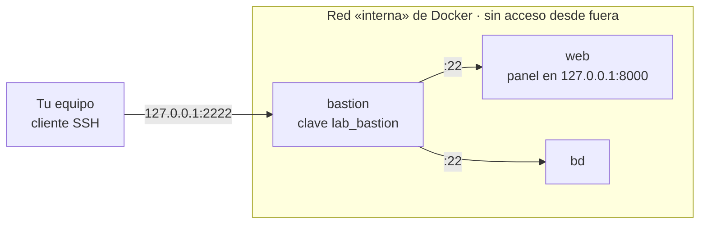

# Práctica guiada: el cliente SSH a fondo, paso a paso

Vas a conectarte por SSH a tres servidores, uno de ellos visible y dos escondidos detrás de él, como pasa en muchas empresas. Empezarás escribiendo comandos larguísimos y acabarás escribiendo solo `ssh web`. Sigue los pasos en orden; cada uno explica qué está pasando y cómo comprobar que ha funcionado. Al final enseñarás al profesor que todo funciona.

## Antes de empezar



El laboratorio son tres contenedores con un servidor SSH. Solo el **bastión** se ve desde tu equipo, en el puerto 2222. Los otros dos, `web` y `bd`, están en una red interna y solo se llega a ellos **pasando por el bastión**. Es lo que se hace con los servidores de producción: no se exponen a Internet y se entra por una única puerta bien vigilada.

| Servidor | Cómo se llega | Usuario | Clave que acepta |
|---|---|---|---|
| `bastion` | `localhost`, puerto **2222** | `alumno` | `lab_bastion` |
| `web` | **solo** desde `bastion` | `alumno` | `lab_interno` |
| `bd` | **solo** desde `bastion` | `alumno` | `lab_interno` |

Ninguno acepta contraseña: solo claves.

Cada paso de la guía tiene hasta tres partes:

- **Haz:** los comandos o ficheros. Cópialos, pero léelos antes.
- **Qué está pasando:** la explicación. Es lo que entra en el examen.
- **Comprueba:** lo que tienes que ver. Si no lo ves, no sigas: mira la última sección, «Si algo falla».

Algunos pasos fallan **a propósito**. Están marcados con «Fallo provocado»: son los errores que te encontrarás trabajando con servidores reales, y aprenderás a reconocerlos.

**Necesitas:** Docker con Docker Compose y un terminal. En el aula trabajas con **Docker rootless**: Docker funciona con tu propio usuario, sin permisos de administrador. En ningún paso de esta práctica necesitas `sudo`.

**Duración aproximada:** 2 horas.

Comprueba que tienes todo:

```bash
docker compose version
ssh -V
ss -ltn | grep -E ':(2222|8080) '     # no debe salir nada
```

Si el último comando muestra algo escuchando en el 2222 o el 8080, avisa al profesor antes de seguir.

## Parte 0. Montar el laboratorio

### Paso 0.1. Guardar tu configuración actual

**Haz:**

```bash
ls -l ~/.ssh/config
```

Si el fichero **existe**, apártalo para empezar de cero:

```bash
mv ~/.ssh/config ~/.ssh/config.antes
```

Si dice `No such file or directory`, no tienes que hacer nada.

**Qué está pasando.** Durante la práctica vas a escribir tu `~/.ssh/config` desde cero. Si ya tenías uno (por ejemplo, para Forgejo o GitHub), lo guardas aparte para no perderlo. En la parte 6 lo recuperarás.

### Paso 0.2. Descargar los ficheros

**Haz:** descarga `lab-ssh.zip` del aula virtual y descomprímelo en tu carpeta personal:

```bash
cd ~
unzip ~/Descargas/lab-ssh.zip
cd ~/lab-ssh
ls
```

**Comprueba:** ves `compose.yaml`, `Dockerfile`, `entrypoint.sh`, `sshd_lab.conf` y una carpeta `claves/` vacía.

A partir de aquí, los comandos de `docker compose` se ejecutan **dentro de `~/lab-ssh`**.

### Paso 0.3. Crear dos pares de claves

**Haz:**

```bash
ssh-keygen -t ed25519 -f ~/.ssh/lab_bastion -C "bastion-$USER"
ssh-keygen -t ed25519 -f ~/.ssh/lab_interno -C "interno-$USER" -N ""
```

El primero te pedirá una ***passphrase***: pon una que recuerdes (dos veces). El segundo no pregunta nada.

**Qué está pasando.**

- `-t ed25519` elige el tipo de clave, el recomendado hoy.
- `-f` fija el nombre del fichero. Cada orden crea **dos** ficheros: la clave **privada** (`lab_bastion`) y la **pública** (`lab_bastion.pub`).
- `-C` añade un comentario para reconocer la clave más adelante.
- `-N ""` deja la clave sin *passphrase*. La de los servidores internos va sin ella solo porque es un laboratorio; la del bastión, la puerta de entrada, sí la lleva.
- Usas **una clave distinta para cada destino**: si te roban una, solo pierdes ese acceso.

**Comprueba:**

```bash
ls -l ~/.ssh/lab_*
```

Hay cuatro ficheros. Las privadas tienen permisos `-rw-------` (solo tú puedes leerlas).

### Paso 0.4. Dar las claves públicas al laboratorio

**Haz:**

```bash
cp ~/.ssh/lab_bastion.pub claves/bastion.pub
cp ~/.ssh/lab_interno.pub claves/interno.pub
ls claves
```

**Qué está pasando.** Para que un servidor te deje entrar con una clave, tiene que tener tu clave **pública** en su lista de claves autorizadas (`~/.ssh/authorized_keys`). Al arrancar, cada contenedor copia la pública que le toca desde esta carpeta. La clave **privada nunca sale de tu equipo**: si alguna vez te piden que la copies a un servidor, algo está mal.

**Comprueba:** en `claves/` solo hay ficheros `.pub`.

### Paso 0.5. Arrancar

**Haz:** la primera vez se construye la imagen, y tarda unos minutos porque toda la clase descarga a la vez.

```bash
docker compose up -d --build
docker compose ps
```

**Comprueba:** `bastion`, `web` y `bd` aparecen en estado `running`, y solo `bastion` tiene un puerto publicado: `127.0.0.1:2222->22/tcp`.

### Paso 0.6. Comprobar que web y bd están escondidos

**Haz:**

```bash
ping -c1 web
ssh alumno@web
```

**Qué está pasando.** Los dos fallan porque tu equipo no sabe qué es `web`: ese nombre solo existe dentro de la red interna de Docker, y desde fuera no se puede llegar a ella. La única puerta es el puerto 2222 del bastión.

**Comprueba:** los dos comandos responden con un error del tipo `Name or service not known` (o «Nombre o servicio desconocido»).

## Parte 1. La forma larga, sin configuración

En esta parte te conectas escribiendo todas las opciones a mano. Así verás qué problema resuelve el fichero de configuración.

### Paso 1.1. Entrar en el bastión

**Haz:**

```bash
ssh -p 2222 -i ~/.ssh/lab_bastion -o IdentitiesOnly=yes alumno@localhost
```

La primera vez, SSH te enseña la **huella** del servidor y pregunta si confías en él. Escribe `yes`. Después te pide la *passphrase* de `lab_bastion` (puede salir en una ventana del escritorio en lugar de en el terminal; es normal).

Ya dentro:

```bash
hostname
exit
```

**Qué está pasando.**

- `-p 2222`: el puerto, porque no es el 22 de siempre.
- `-i ~/.ssh/lab_bastion`: la clave privada que hay que usar.
- `-o IdentitiesOnly=yes`: usa **solo** esa clave, aunque tengas otras.
- `alumno@localhost`: usuario y servidor.
- La huella que has aceptado se guarda en `~/.ssh/known_hosts`. La próxima vez, SSH comprobará que el servidor sigue siendo el mismo. Lo verás en la parte 8.

**Comprueba:** `hostname` responde `bastion`.

### Paso 1.2. Fallo provocado: saltar a web con `-J`

**Haz:** primero vacía el agente de claves para que la prueba sea limpia (si da un error, no pasa nada):

```bash
ssh-add -D
```

Ahora intenta llegar a `web` **a través** del bastión con la opción `-J` (*jump*, saltar):

```bash
ssh -J alumno@localhost:2222 -i ~/.ssh/lab_interno -o IdentitiesOnly=yes alumno@web
```

**Qué ves:**

```
alumno@localhost: Permission denied (publickey).
Connection closed by UNKNOWN port 65535
```

Fíjate en **quién** te rechaza: `alumno@localhost`, es decir, el bastión, no `web`.

**Qué está pasando.** Con `-J`, SSH abre **otra** conexión, un segundo `ssh`, para llegar al bastión. Ese segundo `ssh` **no recibe** las opciones que has escrito (`-i`, `-o`): esas son para `web`. Así que intenta entrar en el bastión sin la clave `lab_bastion`, y el bastión lo rechaza. Acuérdate de esto: en la parte 4 lo resolverás.

Si en tu equipo ha funcionado, es que el agente de tu escritorio ha ofrecido la clave por su cuenta. No pasa nada: lee igualmente la explicación.

### Paso 1.3. La forma más larga

**Haz:** indica a mano cómo se hace el salto, con todas sus opciones:

```bash
ssh -o ProxyCommand="ssh -p 2222 -i ~/.ssh/lab_bastion -o IdentitiesOnly=yes -W %h:%p alumno@localhost" \
    -i ~/.ssh/lab_interno -o IdentitiesOnly=yes alumno@web
```

Te pedirá la *passphrase* del bastión y, como es la primera vez que te conectas a `web`, su huella: escribe `yes`. Ya dentro:

```bash
hostname
exit
```

**Qué está pasando.** `ProxyCommand` es el comando que SSH usa para «llegar» al servidor. Aquí es un `ssh` al bastión con sus propias opciones, y `-W %h:%p` le pide al bastión que reenvíe el tráfico hasta `web`, puerto 22 (`%h` y `%p` se sustituyen por el servidor y el puerto de destino). Por dentro de ese túnel viaja la conexión a `web`, con la clave `lab_interno`.

**Comprueba:** `hostname` responde `web`. Lo has conseguido… con unos 150 caracteres. En la parte siguiente lo dejarás en `ssh web`.

## Parte 2. Tu primer `~/.ssh/config`

### Paso 2.1. El primer alias

**Haz:** crea el fichero con `nano ~/.ssh/config` y escribe:

```
Host bastion
    HostName localhost
    Port 2222
    User alumno
    IdentityFile ~/.ssh/lab_bastion
    IdentitiesOnly yes
```

Guarda (`Ctrl+O`, `Intro`) y sal (`Ctrl+X`). Después ajusta los permisos:

```bash
chmod 600 ~/.ssh/config
```

**Qué está pasando.** Cada bloque empieza con `Host` seguido de un **alias**, el nombre que tú vas a escribir. Las líneas de debajo son las opciones que antes ponías a mano:

| Directiva | Qué indica | Antes era |
|---|---|---|
| `Host` | El alias que tú escribes | — |
| `HostName` | El nombre o la IP real del servidor | `@localhost` |
| `Port` | El puerto | `-p 2222` |
| `User` | El usuario remoto | `alumno@` |
| `IdentityFile` | La clave privada | `-i` |
| `IdentitiesOnly` | Usar solo esa clave | `-o IdentitiesOnly=yes` |

La sangría solo sirve para leer mejor: un bloque llega hasta el siguiente `Host`. El `chmod 600` es obligatorio: SSH se niega a leer un fichero de configuración que otros usuarios puedan modificar.

### Paso 2.2. Usarlo

**Haz:**

```bash
ssh bastion hostname
```

**Qué está pasando.** Puedes poner un comando después del alias: SSH lo ejecuta en el servidor, te muestra el resultado y cierra la conexión. Fíjate en que **no** te pregunta la huella: `known_hosts` guarda el servidor **real** (`[localhost]:2222`), no el alias, y ese ya lo aceptaste en el paso 1.1.

**Comprueba:** después de la *passphrase*, responde `bastion`.

### Paso 2.3. Ver lo que calcula SSH

**Haz:**

```bash
ssh -G bastion | grep -E '^(hostname|port|user|identityfile|identitiesonly) '
```

**Qué está pasando.** `ssh -G` muestra **todas** las opciones que SSH aplicaría a ese alias, **sin conectarse**. Es la herramienta de diagnóstico más útil de toda la práctica: cuando algo no funcione, empieza siempre por aquí.

**Comprueba:** aparecen, entre otras, estas líneas:

```
user alumno
hostname localhost
port 2222
identityfile ~/.ssh/lab_bastion
identitiesonly yes
```

## Parte 3. El orden de las reglas y los valores por defecto

### Paso 3.1. Fallo provocado: `Host *` al principio

**Haz:** abre `~/.ssh/config` y añade estas dos líneas **al principio**, antes de `Host bastion`:

```
Host *
    User nadie
```

Después:

```bash
ssh -G bastion | grep '^user '
ssh bastion hostname
```

**Qué ves:**

```
user nadie
nadie@localhost: Permission denied (publickey).
```

**Qué está pasando.** `Host *` coincide con **cualquier** alias. SSH lee el fichero de arriba abajo y, **para cada opción, se queda con el primer valor que encuentra**. Como `Host *` está arriba, fija el usuario a `nadie`, y cuando llega al bloque `bastion` el usuario ya está decidido: su `User alumno` se ignora.

Cuidado, porque muchos programas funcionan al revés (gana el último valor). En SSH gana el **primero**. Por eso:

- lo **concreto** (cada servidor) va **arriba**;
- lo **general** (`Host *`) va **al final**, y solo rellena lo que nadie ha definido antes.

### Paso 3.2. Valores comunes en `Host *`, al final

**Haz:** deja `~/.ssh/config` exactamente así. Fíjate en que `IdentitiesOnly` sale del bloque `bastion` y pasa a `Host *`:

```
Host bastion
    HostName localhost
    Port 2222
    User alumno
    IdentityFile ~/.ssh/lab_bastion

Host *
    IdentitiesOnly yes
    AddKeysToAgent yes
    ServerAliveInterval 30
    ServerAliveCountMax 3
```

**Qué está pasando.** Estas cuatro opciones te convienen para **todos** los servidores:

- `IdentitiesOnly yes`: ofrece solo la clave indicada en `IdentityFile`. Sin ella, SSH prueba una tras otra todas las claves que tengas, y cada clave rechazada cuenta como un intento fallido. Muchos servidores cortan a los 3 intentos (`MaxAuthTries 3`) y te echan con `Too many authentication failures` antes de llegar a la buena.
- `AddKeysToAgent yes`: guarda la clave en el **agente** la primera vez que escribes la *passphrase* (lo ves en el paso 3.4).
- `ServerAliveInterval 30` y `ServerAliveCountMax 3`: cada 30 segundos envían una señal para que el cortafuegos no corte una sesión inactiva, y dan la conexión por perdida tras 3 señales sin respuesta, en lugar de dejar el terminal colgado.

### Paso 3.3. Comprobar el orden

**Haz:**

```bash
ssh -G bastion | grep -E '^(user|identitiesonly|serveraliveinterval) '
```

**Comprueba:**

```
user alumno
identitiesonly yes
serveraliveinterval 30
```

El usuario vuelve a ser `alumno`, y `IdentitiesOnly` se sigue aplicando aunque ya no esté en el bloque `bastion`: lo rellena `Host *`.

### Paso 3.4. El agente: la *passphrase*, una sola vez

**Haz:**

```bash
ssh-add -l
```

Si responde `Could not open a connection to your authentication agent`, arranca un agente en este terminal y sigue trabajando en él:

```bash
eval "$(ssh-agent -s)"
```

Ahora conéctate **dos veces seguidas** y mira de nuevo el agente:

```bash
ssh bastion hostname
ssh bastion hostname
ssh-add -l
```

**Qué está pasando.** El **agente** (`ssh-agent`) es un pequeño programa que guarda en memoria tus claves ya descifradas y firma por ti cuando un servidor lo pide. Con `AddKeysToAgent yes`, la primera conexión te pide la *passphrase* y deja la clave en el agente; la segunda ya no pregunta nada. La clave sigue cifrada en el disco: si alguien copia el fichero, no le sirve sin la *passphrase*. Es el equilibrio entre seguridad y comodidad.

**Comprueba:** la *passphrase* solo se pide en la primera conexión, y `ssh-add -l` muestra una línea que termina en `bastion-tuusuario (ED25519)`: es el comentario que pusiste con `-C` en el paso 0.3.

## Parte 4. Saltar a los servidores internos con ProxyJump

### Paso 4.1. Un bloque para web y bd

**Haz:** añade este bloque **entre** `Host bastion` y `Host *`:

```
Host web bd
    User alumno
    IdentityFile ~/.ssh/lab_interno
    ProxyJump bastion
```

**Qué está pasando.**

- Un bloque puede servir a **varios** alias a la vez: `Host web bd`.
- No hace falta `HostName`: si no lo pones, SSH usa el propio alias, `web` o `bd`.
- `ProxyJump bastion` dice: «para llegar aquí, salta antes por el alias `bastion`». Y aquí está la solución al fallo del paso 1.2: el `ssh` que hace el salto **lee el bloque `bastion`** de este fichero, con su puerto, su usuario y su clave.

### Paso 4.2. Probar

**Haz:**

```bash
ssh web hostname
ssh bd hostname
ssh bd -- ip -br addr
```

La primera vez que te conectes a `bd` te preguntará su huella: escribe `yes`. (La de `web` ya la aceptaste en el paso 1.3.)

**Qué está pasando.** Cada `ssh web` son, en realidad, **dos** conexiones SSH, una dentro de otra:

1. Tu equipo → bastión, con la clave `lab_bastion`. El bastión solo hace de túnel: abre una conexión al puerto 22 de `web` y le pasa los datos.
2. Tu equipo → `web`, **por dentro** de la primera, con la clave `lab_interno` y cifrada de extremo a extremo. El bastión no puede leerla.

Por eso el nombre `web` lo resuelve **el bastión** (es él quien abre la conexión), y la clave `lab_interno` **no sale nunca de tu equipo**.

**Comprueba:** los dos `hostname` responden `web` y `bd`, sin pedirte nada más. El último comando muestra las interfaces de `bd`, con una IP de la red interna de Docker.

### Paso 4.3. Ver el túnel desde el bastión

**Haz:** abre una sesión en `web` y déjala abierta:

```bash
ssh web
```

En **otro terminal**:

```bash
ssh bastion -- ss -tn
```

**Qué está pasando.** `ss -tn` lista las conexiones TCP del bastión. Verás dos tipos: las que llegan desde tu equipo al bastión y una que **sale del bastión hacia el puerto 22 de `web`**. Esa última es el túnel por el que viaja tu sesión en `web`. Sal de la sesión de `web` con `exit`.

**Comprueba:** hay una línea `ESTAB` cuya última columna (la dirección remota) termina en `:22`: es la conexión hacia `web`.

Hay otras dos formas de llegar a un servidor interno, y las dos son peores:

| Forma | Riesgo |
|---|---|
| **ProxyJump** (la tuya) | Ninguno extra: la clave no sale de tu equipo |
| `ForwardAgent yes` | El administrador del bastión puede usar tu agente mientras estás conectado |
| Copiar la clave privada al bastión | Quien entre en el bastión entra en todos los servidores |

## Parte 5. Un túnel declarado

El servidor `web` tiene un panel interno que **solo escucha en su propio `127.0.0.1:8000`**: ni siquiera el bastión puede verlo. Lo vas a abrir en tu navegador con un túnel.

### Paso 5.1. El alias del túnel

**Haz:** en el bloque de los servidores internos, añade `web-panel` a la lista de alias:

```
Host web bd web-panel
```

Y, justo debajo de ese bloque, añade uno nuevo:

```
Host web-panel
    HostName web
    LocalForward 8080 127.0.0.1:8000
```

Tu fichero queda así:

```
Host bastion
    HostName localhost
    Port 2222
    User alumno
    IdentityFile ~/.ssh/lab_bastion

Host web bd web-panel
    User alumno
    IdentityFile ~/.ssh/lab_interno
    ProxyJump bastion

Host web-panel
    HostName web
    LocalForward 8080 127.0.0.1:8000

Host *
    IdentitiesOnly yes
    AddKeysToAgent yes
    ServerAliveInterval 30
    ServerAliveCountMax 3
```

**Qué está pasando.** `web-panel` coge de **dos** bloques: del primero, el usuario, la clave y el salto; del segundo, el servidor real y el túnel. Así no repites nada.

En `LocalForward 8080 127.0.0.1:8000`:

- `8080` es un puerto de **tu equipo**;
- `127.0.0.1:8000` es el destino, y se interpreta **en el servidor al que te conectas**, `web`. Ese `127.0.0.1` es el de `web`, no el tuyo.

### Paso 5.2. Abrir el túnel

**Haz:**

```bash
ssh -N web-panel
```

Parece que no hace nada: se queda esperando. Es correcto. En **otro terminal**:

```bash
curl http://localhost:8080
```

También puedes abrir `http://localhost:8080` en Firefox.

**Qué está pasando.** `-N` abre la conexión sin abrir una shell: solo sirve para mantener el túnel. Todo lo que llega al puerto 8080 de tu equipo viaja cifrado por SSH, atraviesa el bastión y sale en `web` hacia su `127.0.0.1:8000`.

**Comprueba:** `curl` devuelve `<h1>Panel interno de web</h1><p>Solo accesible desde 127.0.0.1</p>`. Cierra el túnel con `Ctrl+C` en el primer terminal.

### Paso 5.3. Fallo provocado: el destino equivocado

**Haz:** abre un túnel con la opción `-L` de la línea de órdenes (es lo mismo que `LocalForward`), pero poniendo `web` como destino en lugar de `127.0.0.1`:

```bash
ssh -N -L 9000:web:8000 web
```

En otro terminal:

```bash
curl http://localhost:9000
```

**Qué ves:** `curl` falla, y en el terminal del túnel aparece:

```
channel 2: open failed: connect failed: Connection refused
```

(El número de `channel` puede ser otro.)

**Qué está pasando.** El destino lo interpreta `web`. Para `web`, el nombre `web` es la IP de su tarjeta de red, no su `127.0.0.1`. Como el panel solo escucha en `127.0.0.1`, rechaza la conexión. El túnel se abre bien; lo que falla es el último tramo, dentro de `web`. Cierra con `Ctrl+C`.

### Paso 5.4. El túnel en segundo plano

**Haz:**

```bash
ssh -fN web-panel
curl http://localhost:8080
```

Para cerrarlo, busca el proceso y termínalo con su número (PID):

```bash
pgrep -af web-panel
kill 12345        # cambia 12345 por el número que te ha salido
```

**Qué está pasando.** `-f` manda SSH a segundo plano después de conectar, y te devuelve el terminal. Es cómodo, pero el túnel sigue abierto hasta que lo cierres: si lo olvidas y vuelves a lanzarlo, verás `Address already in use` porque el 8080 sigue ocupado.

**Comprueba:** después del `kill`, `curl http://localhost:8080` falla con `Connection refused`.

## Parte 6. Ordenar la casa con `Include`

Con varios proyectos, un único `~/.ssh/config` crece sin control. Lo vas a partir en ficheros.

### Paso 6.1. Un fichero para el laboratorio

**Haz:**

```bash
mkdir -m 700 ~/.ssh/config.d
nano ~/.ssh/config.d/lab.conf
```

Escribe en `lab.conf` los **tres bloques del laboratorio** (`bastion`, `web bd web-panel` y `web-panel`), copiados de tu `~/.ssh/config`. Después:

```bash
chmod 600 ~/.ssh/config.d/lab.conf
```

### Paso 6.2. El fichero principal

**Haz:** deja `~/.ssh/config` así:

```
Include config.d/*.conf

Host *
    IdentitiesOnly yes
    AddKeysToAgent yes
    ServerAliveInterval 30
    ServerAliveCountMax 3
```

Si en el paso 0.1 guardaste un `config.antes`, pega ahora su contenido **entre** la línea `Include` y `Host *`. Si tenía su propio `Host *`, no lo copies: junta sus opciones con las de este.

**Qué está pasando.**

- `Include config.d/*.conf` mete en ese punto todos los ficheros `.conf` de la carpeta, como si estuvieran escritos ahí. La ruta es relativa a `~/.ssh`.
- Va en la **primera línea** por la misma regla de la parte 3: los bloques concretos tienen que leerse antes que `Host *`.
- Así puedes tener un fichero por proyecto (`lab.conf`, `git.conf`, `trabajo.conf`) y borrar uno entero cuando termines.

**Comprueba:**

```bash
ssh bastion hostname
ssh web hostname
```

Responden `bastion` y `web`, igual que antes.

### Paso 6.3. Fallo provocado: el `Include` dentro de un bloque

**Haz:** cambia la primera línea de `~/.ssh/config` por estas tres:

```
Host otro
    HostName 192.0.2.10
    Include config.d/*.conf
```

Y prueba:

```bash
ssh bastion hostname
```

**Qué ves:**

```
ssh: Could not resolve hostname bastion: Name or service not known
```

**Qué está pasando.** Un `Include` escrito **dentro** de un bloque solo se lee cuando ese bloque coincide; aquí, solo al conectar a `otro`. Para cualquier otro alias, los bloques del laboratorio no existen, y SSH intenta buscar en la red un servidor que se llame `bastion`.

**Haz:** deja la primera línea como estaba, `Include config.d/*.conf`, y comprueba que `ssh bastion hostname` vuelve a funcionar.

## Parte 7. Todas las herramientas usan los alias

Todo lo que funciona sobre SSH lee el mismo `~/.ssh/config`: el alias, el usuario, la clave y el salto por el bastión vienen gratis.

**Haz:** desde `~/lab-ssh`:

```bash
echo "Informe de $USER" > informe.txt
scp informe.txt bd:~
ssh bd cat informe.txt
```

```bash
mkdir -p dist
echo "<h1>Hola desde $USER</h1>" > dist/index.html
rsync -av dist/ web:~/dist/
ssh web cat dist/index.html
```

```bash
scp -3 web:/etc/hostname bd:~/hostname-de-web
ssh bd cat hostname-de-web
```

```bash
sftp bd
```

Dentro de `sftp`: `ls`, `get informe.txt informe-copia.txt` y `bye`.

**Qué está pasando.**

| Herramienta | Qué hace |
|---|---|
| `scp` | Copia un fichero |
| `rsync` | Sincroniza carpetas y solo envía lo que ha cambiado. Es lo que se usa para desplegar una web en un servidor |
| `scp -3` | Copia de un servidor a otro **pasando por tu equipo**. Sin `-3`, sería `web` quien intentara conectar con `bd`, y no tiene ninguna clave para hacerlo (ni debe tenerla) |
| `sftp` | Una sesión interactiva para subir y bajar ficheros |

Ninguna lleva usuario, puerto ni clave. Si usas VS Code, la extensión **Remote - SSH** también lee este fichero: tus alias aparecen solos en su lista.

**Comprueba:** `informe.txt` aparece en `bd`; `dist/index.html`, en `web`; `hostname-de-web` contiene `web`; y en tu carpeta tienes `informe-copia.txt`.

## Parte 8. Diagnóstico y errores provocados

### Paso 8.1. Fallo provocado: permisos

**Haz:**

```bash
chmod 664 ~/.ssh/config
ssh bastion hostname
```

**Qué ves:**

```
Bad owner or permissions on /home/tuusuario/.ssh/config
```

**Qué está pasando.** Con `664`, tu grupo también puede modificar el fichero. Alguien podría cambiar a qué servidor te conectas o qué clave usas, así que SSH se niega a leerlo y no hace **nada**, con ningún alias.

**Haz:** déjalo bien:

```bash
chmod 600 ~/.ssh/config
```

### Paso 8.2. Fallo provocado: el servidor ha cambiado

**Haz:** recrea el bastión, que es lo mismo que reinstalarlo:

```bash
docker compose up -d --force-recreate bastion
ssh bastion hostname
```

**Qué ves:** un aviso enorme que empieza así:

```
@@@@@@@@@@@@@@@@@@@@@@@@@@@@@@@@@@@@@@@@@@@@@@@@@@@@@@@@@@@
@    WARNING: REMOTE HOST IDENTIFICATION HAS CHANGED!     @
@@@@@@@@@@@@@@@@@@@@@@@@@@@@@@@@@@@@@@@@@@@@@@@@@@@@@@@@@@@
```

Léelo **entero**. Más abajo indica el servidor afectado, `[localhost]:2222`, y termina con `Host key verification failed.`

**Qué está pasando.** Cada servidor tiene su propia clave de **host**, que lo identifica. La primera vez que te conectas, SSH guarda su huella en `known_hosts`, y a partir de ahí comprueba que coincide. Al recrear el contenedor se han generado claves de host nuevas, así que la huella ya no coincide.

Aquí sabes por qué ha cambiado: lo acabas de recrear tú. Pero ese mismo aviso es el que verías si alguien se hubiera colocado entre tú y el servidor para hacerse pasar por él (un ataque *man-in-the-middle*). La regla es:

- **Si sabes por qué ha cambiado** (lo has reinstalado tú), borra la huella antigua.
- **Si no lo sabes** (nadie lo ha tocado, es un servidor de producción o estás en una red que no controlas), **no la borres**: confirma la huella nueva por otro canal, por ejemplo preguntando a quien lo administra.
- **Nunca** pongas `StrictHostKeyChecking no` para que el aviso desaparezca: es desactivar tu única defensa contra ese ataque.

**Haz:** borra la entrada antigua, con el nombre **exacto** que indica el aviso:

```bash
ssh-keygen -R '[localhost]:2222'
ssh bastion hostname
```

Los corchetes y el puerto son necesarios porque no es el 22: `ssh-keygen -R localhost` no borraría nada.

**Comprueba:** SSH te pregunta la huella nueva como la primera vez; escribe `yes` y responde `bastion`.

### Paso 8.3. Leer la traza

**Haz:**

```bash
ssh -v web exit 2>&1 | grep -E 'Applying options|ProxyCommand|Authenticated to'
```

**Qué está pasando.** `-v` (*verbose*) cuenta todo lo que hace SSH. Con el `grep` te quedas con tres cosas:

- `Applying options for …`: qué bloques de tu configuración se aplican, en qué fichero y en qué línea;
- `ProxyCommand`: el `ssh -W` que lanza SSH para saltar por el bastión, el mismo que escribiste a mano en el paso 1.3;
- `Authenticated to …`: con qué servidor y qué método ha entrado. Saldrán dos: uno para el bastión y otro para `web`.

Si necesitas aún más detalle, usa `-vvv`.

**Comprueba:** ves las tres cosas, y una de las líneas `Applying options` menciona `config.d/lab.conf`.

### Paso 8.4. El registro del servidor

**Haz:**

```bash
docker compose logs web | grep Accepted
```

**Qué está pasando.** Es el otro lado: el servidor anota cada entrada, con el usuario, la dirección de origen y la huella de la clave usada. Fíjate en la dirección de origen: no es tu equipo, es **el bastión**. Para `web`, quien se conecta siempre es el bastión.

**Comprueba:** ves líneas `Accepted publickey for alumno from 172.…`.

Cuando algo falle con SSH, sigue siempre este orden: primero `ssh -G` (¿he escrito bien la configuración?), después `ssh -v` (¿qué pasa al conectar?) y por último el registro del servidor.

## Parte 9. Ampliación: dos cuentas de GitHub en el mismo equipo

Esta parte es **opcional**. Necesitas dos cuentas de GitHub, por ejemplo una personal y otra del instituto. GitHub no deja usar la **misma** clave en dos cuentas.

### Paso 9.1. Una clave para la segunda cuenta

**Haz:**

```bash
ssh-keygen -t ed25519 -f ~/.ssh/github_clase -C "github-clase-$USER"
cat ~/.ssh/github_clase.pub
```

Copia la línea que sale y añádela en tu **segunda** cuenta de GitHub: *Settings → SSH and GPG keys → New SSH key*.

### Paso 9.2. Un fichero para Git

**Haz:** crea `~/.ssh/config.d/git.conf` con permisos `600`:

```
Host github.com
    User git
    IdentityFile ~/.ssh/id_ed25519

Host github-clase
    HostName github.com
    User git
    IdentityFile ~/.ssh/github_clase
```

Cambia `~/.ssh/id_ed25519` por la clave que ya uses en tu cuenta personal.

**Qué está pasando.** Los dos alias van al mismo servidor, `github.com`, pero cada uno con su clave. Como GitHub reconoce la cuenta **por la clave**, eliges la cuenta eligiendo el alias.

**Comprueba:**

```bash
ssh -T git@github.com
ssh -T github-clase
```

Cada uno saluda con **un nombre de usuario distinto**: `Hi usuario! You've successfully authenticated…`. Para clonar un repositorio de la segunda cuenta, usa el alias en lugar de `github.com`:

```bash
git clone github-clase:usuario/repositorio.git
```

## Demostración final al profesor

Cuando termines, llama al profesor y enséñale en directo, en este orden, que todo funciona. Son unos 5 minutos. Ve marcando cada punto.

- [ ] **Contenedores.** `docker compose ps` muestra `bastion`, `web` y `bd` en marcha, y solo `bastion` tiene un puerto publicado, en `127.0.0.1:2222`.
- [ ] **Alias.** `ssh web hostname` y `ssh bd hostname` responden sin escribir ninguna opción.
- [ ] **Lo que calcula SSH.** `ssh -G web | grep -E '^(user|identityfile|proxyjump) '` muestra `alumno`, `lab_interno` y `bastion`.
- [ ] **Agente.** `ssh-add -l` muestra la clave del bastión, y una conexión nueva no pide la *passphrase*.
- [ ] **Túnel.** `ssh -fN web-panel` y `curl http://localhost:8080` muestran el panel. Después lo cierras con `pgrep` y `kill`.
- [ ] **Orden del fichero.** `cat ~/.ssh/config`: el `Include` en la primera línea y `Host *` al final.
- [ ] **Permisos y claves.** `ls -ld ~/.ssh/config ~/.ssh/config.d ~/.ssh/config.d/lab.conf` muestra `-rw-------` en los dos ficheros y `drwx------` en la carpeta, y en `~/lab-ssh/claves` solo hay ficheros `.pub`.
- [ ] **Despliegue.** Cambia tu `dist/index.html`, vuelve a hacer el `rsync` a `web` y enseña el cambio con `ssh web cat dist/index.html`.
- [ ] **Explícalo.** El profesor te hará una pregunta de las que aparecen en «Qué está pasando». Por ejemplo: por qué `Host *` va al final, quién resuelve el nombre `web`, dónde se interpreta el `127.0.0.1` de `LocalForward` o cuándo es peligroso borrar una huella.

Sube después a la tarea del aula virtual tus ficheros `~/.ssh/config` y `~/.ssh/config.d/lab.conf`, **como texto**. Nunca subas un fichero de clave **privada**.

## Al terminar

```bash
cd ~/lab-ssh
docker compose down
```

Para y borra los contenedores. Tus claves y tu configuración se quedan. Si vuelves a levantar el laboratorio otro día, los contenedores tendrán claves de host **nuevas** y verás el aviso del paso 8.2 en los tres servidores: ya sabes por qué y cómo resolverlo.

## Si algo falla

Antes de preguntar, mira los logs: `docker compose logs bastion` (o `web`, o `bd`). Y para la configuración del cliente, `ssh -G` y `ssh -v`.

| Lo que ves | Por qué pasa | Qué hacer |
| --- | --- | --- |
| `docker compose up --build` muy lento o con `timeout` | Toda la clase descarga la imagen base a la vez | Espera un poco y repítelo; solo se descarga una vez |
| Un contenedor se para nada más arrancar y su log dice `install: omitting directory '/claves/authorized_keys'` | Arrancaste antes de copiar las `.pub`, y Docker creó **carpetas** con esos nombres | `docker compose down`, `rmdir claves/bastion.pub claves/interno.pub`, repite el paso 0.4 y vuelve a arrancar |
| `bind: address already in use` en el 2222 | Te quedó otro laboratorio arrancado | `docker ps` para verlo y `docker compose down` en su carpeta; si no es tuyo, avisa al profesor |
| `Permission denied (publickey)` al entrar en el bastión | La clave pública que tiene el contenedor no es la tuya, o has copiado las `.pub` cruzadas | Revisa el paso 0.4 y después `docker compose restart` |
| `Bad owner or permissions` | Otros usuarios pueden modificar el fichero | `chmod 600` al fichero que indica el error |
| `Could not resolve hostname bastion` | SSH no encuentra el alias: errata en `Host`, el `Include` mal colocado o `lab.conf` con otro nombre | `ssh -G bastion` y revisa la parte 6 |
| `Too many authentication failures` | Falta `IdentitiesOnly yes` y el agente ofrece demasiadas claves | Revisa el `Host *` del paso 3.2 |
| `REMOTE HOST IDENTIFICATION HAS CHANGED` sin haber recreado nada | Has hecho `docker compose down` y `up`: los contenedores son nuevos | `ssh-keygen -R '[localhost]:2222'`, `ssh-keygen -R web` y `ssh-keygen -R bd` |
| `bind [127.0.0.1]:8080: Address already in use` al abrir el túnel | Te quedó un túnel abierto en segundo plano | `pgrep -af web-panel` y `kill` del número que salga |
| `Could not open a connection to your authentication agent` | No hay agente en ese terminal | `eval "$(ssh-agent -s)"` |
| La *passphrase* se pide en una ventana y no en el terminal | Es el agente de tu escritorio | Es normal: escríbela ahí |
| `ssh -T git@github.com` se queda colgado o da `timeout` | La red no deja salir por el puerto 22 | En `git.conf`, añade `HostName ssh.github.com` y `Port 443` a los dos bloques |

## Anexo. Qué hay dentro del laboratorio

No tienes que tocar estos ficheros, pero así sabes qué estás arrancando.

- **`compose.yaml`**: los tres servicios. Solo `bastion` publica un puerto, `127.0.0.1:2222`, y es el único que está en las dos redes. La red `interna` es `internal: true`: no tiene salida al exterior ni puertos publicados.
- **`Dockerfile`**: una imagen Debian con el servidor SSH, `rsync` y el usuario `alumno`. No lleva claves de host: cada contenedor genera las suyas al arrancar, y por eso cambian al recrearlo.
- **`sshd_lab.conf`**: la configuración del servidor SSH. Sin `root`, sin contraseñas, solo claves y solo el usuario `alumno`.
- **`entrypoint.sh`**: lo que hace cada contenedor al arrancar. Genera las claves de host, instala tu clave pública como autorizada y, en `web`, arranca el panel en `127.0.0.1:8000`.
