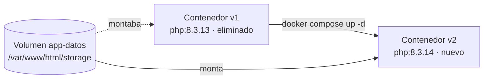

# Imágenes, contenedores y volúmenes: cómo se actualiza un servicio sin perder los datos

Cuando sale un fallo de seguridad en PHP, Apache u OpenSSL, en un servidor clásico harías `apt upgrade` y listo. En Docker la forma correcta es otra: se descarga una imagen nueva y se crea un contenedor nuevo. La primera vez asusta, porque parece que «borras el servidor».

!!! question "La duda"
    Si para aplicar un parche de seguridad borro el contenedor y creo otro… **¿dónde están mis datos?**

Para responder hay que separar tres piezas que solemos mezclar: la **imagen**, el **contenedor** y el **volumen**.

## Imagen y contenedor no son lo mismo

| | Imagen | Contenedor |
| --- | --- | --- |
| Qué es | Paquete inmutable con el sistema base, el software (PHP, Apache…) y el código | Proceso aislado creado a partir de una imagen |
| ¿Cambia? | Nunca: es de solo lectura | Añade encima una capa fina en la que sí puede escribir |
| Ejemplo | `php:8.3-apache` | `docker run php:8.3-apache` |

**Analogía:** la imagen es la clase y el contenedor, el objeto. De una misma imagen puedes sacar tantos contenedores como quieras. Si borras el contenedor, la imagen sigue intacta y puedes crear otro igual en un segundo.

Quédate con esto: **la imagen no se modifica; lo que cambia es qué imagen usas.**

## Una imagen es una pila de capas

| Capa | Tipo | Pertenece a |
| --- | --- | --- |
| Capa escribible | Lectura/escritura | Contenedor |
| 4 · `COPY ./app /var/www/html` | Solo lectura | Imagen |
| 3 · `RUN docker-php-ext-install pdo` | Solo lectura | Imagen |
| 2 · PHP 8.3 + Apache | Solo lectura | Imagen |
| 1 · Debian bookworm (base) | Solo lectura | Imagen |

La tabla se lee de abajo arriba: primero el sistema base, luego PHP, las extensiones y por último tu código.

- Cada instrucción del Dockerfile genera una capa de solo lectura. Las capas se comparten entre imágenes: diez contenedores de PHP usan las mismas en disco.
- Docker junta todas las capas con **OverlayFS** y el contenedor las ve como un único sistema de ficheros.
- El contenedor solo añade la capa escribible de arriba. Si modifica un fichero de la imagen, lo copia a esa capa y lo cambia allí (*copy-on-write*).

Fíjate en que el PHP vulnerable está en la capa 2. Para arreglarlo no se puede tocar esa capa: hay que generar otra imagen con una capa 2 nueva.

## El problema: la capa escribible muere con el contenedor

```bash
$ docker run -d --name web php:8.3-apache
$ docker exec web sh -c 'echo hola > /var/www/html/nota.txt'
$ docker rm -f web
$ docker run -d --name web php:8.3-apache
$ docker exec web cat /var/www/html/nota.txt
cat: /var/www/html/nota.txt: No such file or directory
```

El contenedor nuevo empieza con una capa escribible vacía. Todo lo que el contenedor escribe fuera de un volumen (ficheros subidos, la base de datos, logs, paquetes instalados a mano) desaparece al borrarlo. Por eso decimos que los contenedores son **desechables**.

## La solución: volúmenes

Un volumen es una carpeta que está en el host, fuera de las capas del contenedor, y que Docker monta en una ruta de dentro. Para el proceso es una carpeta más, pero lo que escribe ahí va directamente al disco del host. Cuando borras el contenedor, el volumen no se toca.

| Tipo | Dónde están los datos | Uso típico |
| --- | --- | --- |
| Volumen con nombre | Los gestiona Docker en `/var/lib/docker/volumes/` | Bases de datos, datos de la aplicación |
| Bind mount | Una carpeta concreta del host (`./config`) | Configuración, código en desarrollo |
| tmpfs | En memoria RAM; se borra al parar | Temporales, secretos |

```yaml
volumes:
  - db-datos:/var/lib/postgresql/data       # volumen con nombre
  - ./nginx.conf:/etc/nginx/nginx.conf:ro   # bind mount
```

Fíjate en el formato `origen:destino`. Si el origen es un nombre, es un volumen gestionado por Docker; si empieza por `./` o `/`, es una carpeta del host.

## Cambiar el contenedor, conservar el volumen



El contenedor nuevo monta el mismo volumen en la misma ruta, así que la aplicación encuentra sus datos como si nada hubiera cambiado. Actualizar no es peligroso para los datos: lo que cambias es el software de arriba, no el almacén de abajo. Lo único que tienes que garantizar es que la ruta donde la aplicación guarda sus datos esté montada en un volumen.

## Una imagen no se parchea: se reconstruye

1. **Se publica el arreglo.** El equipo de PHP corrige el fallo y la imagen oficial `php:8.3-apache` se publica de nuevo con la versión arreglada (8.3.13 → 8.3.14).
2. **Descargas o reconstruyes.** Bajas la imagen nueva con `docker pull` o, si la imagen es tuya, la vuelves a construir sobre la base nueva con `docker build --pull`.
3. **Recreas el contenedor.** Docker borra el contenedor viejo y crea uno nuevo con la imagen nueva, que monta los mismos volúmenes.

!!! warning "Nunca `apt upgrade` dentro del contenedor"
    Ese cambio va a la capa escribible y se pierde la próxima vez que se recree el contenedor. Además, nadie sabe qué versión corre realmente. En Docker, la versión del software la decide siempre la imagen.

## Etiquetas y digest: qué versión estás usando

| Referencia | ¿Cambia? | Qué significa |
| --- | --- | --- |
| `php:latest` | A menudo | La última publicada, incluso de otra versión mayor. Evítala en producción |
| `php:8.3-apache` | Con cada parche | Sigue la rama 8.3: recibe los arreglos de seguridad |
| `php:8.3.14-apache` | Casi nunca | Versión exacta: tú decides cuándo subir |
| `php@sha256:9f2c…` | Nunca | Identifica bytes exactos: reproducible al 100 % |

Una etiqueta es un puntero que el publicador puede mover; el digest no. Por eso un `docker pull` de la misma etiqueta puede traer hoy una imagen distinta a la de ayer. Lo normal en producción es fijar la versión mayor y menor (`8.3`) y dejar que los parches lleguen solos.

## Así se actualiza un servicio

1. **Copia de seguridad** de los volúmenes importantes.
2. **Traer la imagen:** `docker compose pull`. Solo descarga: no cambia nada de lo que está en marcha.
3. **Recrear:** `docker compose up -d`. Compose compara: si la imagen ha cambiado, para el contenedor, lo borra y crea otro con la misma configuración y los mismos volúmenes. Los demás servicios los deja tal cual. El corte dura unos segundos.
4. **Comprobar y limpiar:** mira los logs y borra las imágenes viejas.

### Los comandos, según de quién sea la imagen

**Imagen oficial (de otro)**

```bash
# 1. descargar las versiones nuevas
docker compose pull
# 2. recrear lo que haya cambiado
docker compose up -d
# 3. borrar imágenes viejas sin etiqueta
docker image prune
```

**Imagen propia (con Dockerfile)**

```bash
# 1. reconstruir bajando la base nueva
docker compose build --pull
# 2. recrear
docker compose up -d
# 3. comprobar qué versión corre
docker compose exec app php -v
```

`docker image prune` solo borra imágenes que se han quedado **sin etiqueta**. Cuando una etiqueta que se mueve, como `8.3-apache`, pasa a la versión nueva, la anterior se queda sin etiqueta y `prune` la elimina. Una imagen con etiqueta fija, como `php:8.3.10-apache`, hay que borrarla a mano con `docker image rm`.

## ¿Y si la imagen la he hecho yo?

```dockerfile
# el PHP viene de aquí
FROM php:8.2-apache

RUN docker-php-ext-install pdo_pgsql intl

COPY . /var/www/html
```

- El parche llega por la base, tu `FROM`. Tus capas se construyen encima de ella.
- Con `--pull` bajas de nuevo `php:8.2-apache` aunque ya la tengas; sin él reconstruyes sobre la base vieja y no arreglas nada.
- Si la rama deja de recibir parches (fin de soporte), toca cambiar la versión del `FROM` y probar que la aplicación sigue funcionando.
- Un escáner como **Trivy** en la integración continua avisa de las vulnerabilidades conocidas de cada imagen.

## Qué sobrevive a recrear el contenedor

| Elemento | ¿Sobrevive? |
| --- | --- |
| Datos guardados en un volumen o en un bind mount | Sí |
| Variables, puertos y redes definidos en `compose.yaml` | Sí, se aplican al nuevo |
| Ficheros escritos fuera de cualquier volumen | No |
| Paquetes instalados a mano con `docker exec … apt install` | No |
| Configuración editada a mano dentro del contenedor | No |

Sobrevive lo que está fuera del contenedor: en un volumen o en `compose.yaml`. Todo cambio de configuración se hace en el compose, en un fichero montado o en el Dockerfile, nunca entrando con `docker exec` y editando.

## Donde sí se pueden perder datos

| Situación | Qué pasa |
| --- | --- |
| `docker compose down -v` | La opción `-v` borra también los volúmenes con nombre. `down` a secas no los toca |
| Saltos de versión mayor | De Postgres 16 a 17 cambia el formato de los ficheros: hay que exportar e importar (`pg_dump`) o migrar. No basta con cambiar la etiqueta |
| Migraciones de la aplicación | Moodle, Nextcloud o Laravel actualizan su base de datos al arrancar la versión nueva. Si fallan a medias, solo te salva la copia |

!!! tip "Regla"
    Copia de seguridad antes de actualizar, y fija la versión mayor en la etiqueta (`postgres:16`, no `postgres:latest`).

## Dónde están mis volúmenes

```bash
docker volume ls                            # lista los volúmenes
docker volume inspect app-datos             # su Mountpoint en el host
docker inspect -f '{{json .Mounts}}' web    # qué monta un contenedor
docker system df -v                         # cuánto ocupa cada cosa
```

Si un contenedor no monta nada en la ruta donde guarda sus datos, esos datos están en la capa escribible y los perderás al recrearlo. **Compruébalo antes de actualizar**: busca en la documentación de la imagen qué ruta guarda los datos (por ejemplo `/var/lib/postgresql/data` en Postgres) y verifica que aparece como destino de un montaje.

## Caso real: un parche de PHP en producción

Esto se hizo en un servidor en producción el 22 de noviembre de 2026, con los comandos y salidas tal como salieron.

### 1. Llega un aviso de seguridad: ¿me afecta?

PHP 8.3.37 corrige 18 fallos. El peor solo se puede explotar si Nginx reutiliza las conexiones con PHP-FPM. Antes de tocar nada, se comprueba en el contenedor correcto: el Nginx que habla con PHP-FPM por FastCGI (el proxy de entrada y los Nginx estáticos no cuentan).

```bash
# ¿reutiliza Nginx las conexiones con PHP-FPM?
$ docker exec mascreatiu-app-nginx \
    grep -rn fastcgi_keep_conn /etc/nginx/
(sin salida)

# ¿qué versión de PHP corre?
$ docker exec mascreatiu-app php -v
PHP 8.3.36 (cli)
```

- **Sin salida:** la opción está desactivada y ese fallo no se puede explotar. Pero la 8.3.36 tiene los demás fallos: se actualiza igual.
- **Error típico:** buscar en `/etc/nginx` del host. No existe: todo corre en contenedores. Por eso se usa `docker exec`.

### 2. Del contenedor al Dockerfile, y vuelta

1. **Encontrar el proyecto.** Compose deja en cada contenedor una etiqueta con la carpeta desde la que se levantó (`working_dir`), y `docker inspect` la enseña.
2. **Ver de qué base parte.** En el compose, `build: ./app` indica que la imagen no se descarga: se construye con un Dockerfile. Su `FROM php:8.3-fpm-alpine` usa una etiqueta que se mueve, así que no hay que tocar nada.
3. **Comprobar la base nueva.** Se descarga con `docker pull` y se comprueba con un contenedor temporal que ya trae el parche (`php -v` → 8.3.37).
4. **Reconstruir y recrear.** `docker compose build` y después `docker compose up -d mascreatiu-app`.

La construcción tardó 4 minutos con la aplicación funcionando. **`up -d` solo recreó el contenedor de PHP: la base de datos no se tocó.** Compara con la fase 4 del ejercicio: allí bastaba con `pull` y `up`; con una imagen propia hay que construir en medio.

### 3. Comprobar, reiniciar y limpiar

```bash
$ docker exec mascreatiu-app php -v
PHP 8.3.37 (cli)
$ curl -sI https://app.mascreatiu.com
HTTP/1.1 200 OK
$ docker logs --tail 20 mascreatiu-app
NOTICE: ready to handle connections
```

- **Antes de reiniciar el servidor:** los 19 contenedores tienen la política de reinicio `unless-stopped` y vuelven solos. Si alguno tuviera `no`, no arrancaría.
- **Después del reinicio:** el disco de datos de Docker está montado y vuelven los 19 contenedores.
- **Limpieza:** `docker image prune` solo liberó 315 kB, porque las capas viejas siguen en la caché de construcción. Esa caché se limpia aparte con `docker builder prune`.

Del aviso al parche aplicado: unos 15 minutos, sin entrar al contenedor a actualizar nada.

## Idea clave

| Pieza | Qué es |
| --- | --- |
| **Imagen** | Qué software ejecutas. Inmutable: se sustituye entera |
| **Contenedor** | La instancia en marcha. Desechable |
| **Volumen** | Tus datos. Persisten de un contenedor al siguiente |

**Actualizar = cambiar de imagen y recrear el contenedor. Los datos ni se tocan**, siempre que hayas hecho la copia antes.
